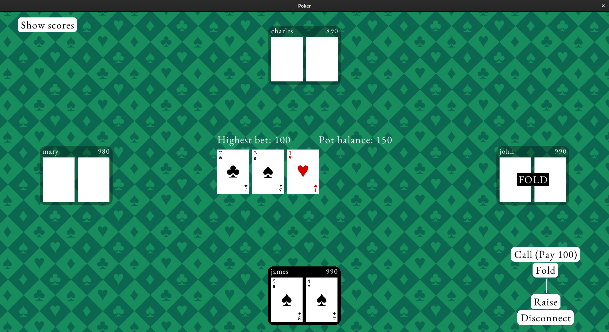

# Poker

A simple multiplayer LAN poker game, using raylib.

## Compiling and running

Clone the repo, and do `./build.sh` if you're on linux or `build.bat` in the VS command line if you're on Windows (you need MSVC installed). This will generate the executable `poker_linux` on linux and `poker_win32.exe` on Windows.

You can then run the executable. Be careful to run the executable from the `poker` directory.